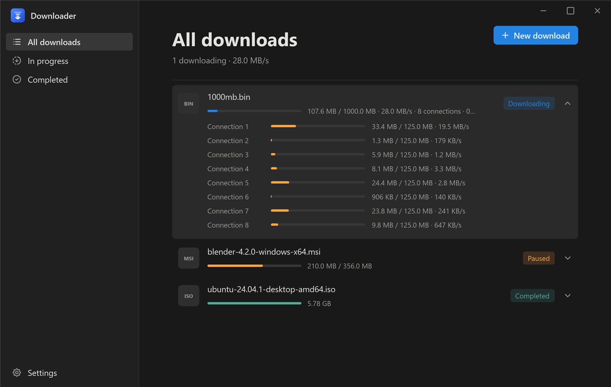
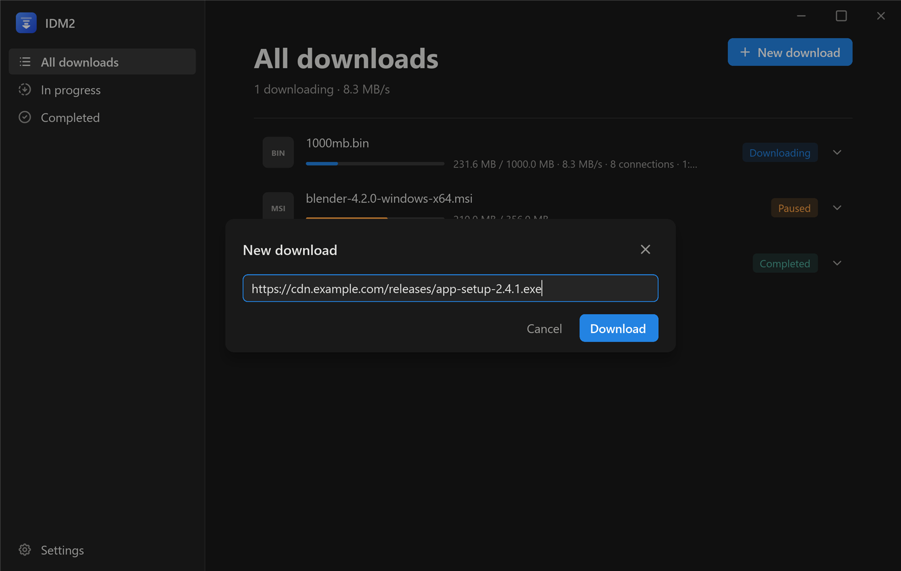
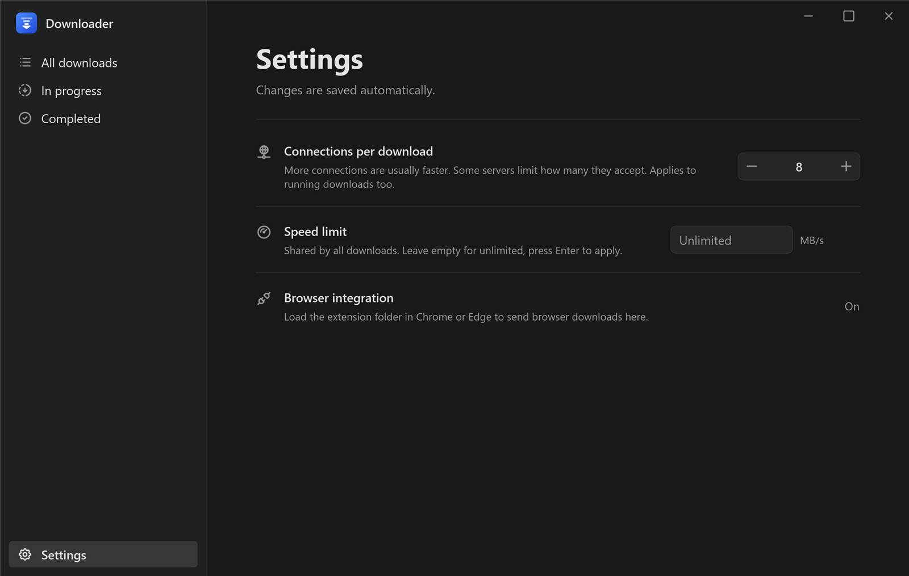

<p align="center">
  
</p>

<h1 align="center">IDM2</h1>

<p align="center">
  A fast, modern download manager for Windows and macOS, written in Rust.<br>
  Multi-connection, resumable downloads with a clean, Notion-style interface.
</p>

<p align="center">
  <a href="dist/IDM2-0.5.0-windows-x64.zip?raw=1"><b>⬇ Download IDM2 0.5.0 for Windows (64-bit)</b></a><br>
  macOS (Apple Silicon and Intel): see <a href="#macos">Installation → macOS</a>
</p>



## Features

- **Multi-connection downloads.** Each file is split into ranges and fetched over up to 32 parallel connections. This is the same idea that makes IDM fast.
- **Dynamic segmentation.** When a connection finishes its range, it takes over the back half of the largest remaining one. All connections stay busy until the last byte, so slow connections don't hold up the end of the download.
- **Resume anywhere.** Pause, quit or lose power, and the download continues from where it stopped. Progress is flushed to disk every second. If the file on the server has changed, the download starts over instead of producing a corrupt file.
- **No merge step.** The output file is created at full size up front and every connection writes directly to its own position. There's no slow "assembling" phase at the end, and a full disk is reported immediately rather than at 90%.
- **Live connection control.** Change the number of connections while a download runs; new connections start within a second.
- **Per-connection progress.** Click a download to see every connection with its own progress bar, bytes and speed.
- **Global speed limit.** One cap shared by all downloads. It throttles at the network level, so it doesn't just buffer data in memory.
- **Download queue.** Up to 3 downloads run at once and the rest wait their turn. The list survives restarts.
- **Starts at login** (optional). IDM2 starts quietly in the tray (the menu bar on macOS) when you sign in, so queued downloads resume and browser downloads are caught right away.
- **Runs in the background.** Closing the window keeps downloads going; IDM2 lives in the system tray. Hover the tray icon for live progress, click it to reopen the window, or right-click it to quit. Starting IDM2 again brings up the running copy instead of opening a second one.
- **Browser integration.** One small extension for Chrome, Edge and Firefox sends browser downloads to the app, including cookies and referrer, so downloads that need a login work too. IDM2's window pops up so you can see the download started. If the app isn't running, the browser simply downloads the file itself.
- **Torrents.** Download magnet links and `.torrent` files, with a live list of the peers you're downloading from. `.torrent` links clicked in the browser are fetched and started automatically. Seeding stops when a download finishes. IDM2 can also become the Windows handler for magnet links and `.torrent` files.
- **Automatic retries.** Dropped connections retry with backoff. If a server refuses extra connections, the remaining ones carry on.
- **Light and dark mode.** Follows your system theme.
- **Windows and macOS.** One universal macOS app runs natively on Apple Silicon and Intel Macs.
- **Command-line mode.** `idm2 <url>` downloads from the terminal with live progress.

## Screenshots

| New download | Settings |
| --- | --- |
|  |  |

## Installation

### Windows

1. Download [`IDM2-0.5.0-windows-x64.zip`](dist/IDM2-0.5.0-windows-x64.zip?raw=1) from the `dist` folder.
2. Unzip it anywhere, for example `C:\Program Files\IDM2`.
3. Run `idm2.exe`.

The app isn't code-signed yet, so Windows SmartScreen may warn the first time you run it. Click **More info**, then **Run anyway**.

Windows 11 puts new tray icons in the hidden overflow (the **^** next to the clock). To keep IDM2 visible, drag its icon onto the taskbar.

### macOS

macOS 11 (Big Sur) or later, on Apple Silicon or Intel.

1. Get `IDM2-<version>-macos-universal.zip`. It's built automatically on every push to `main`: open the repository's **Actions** tab, pick the latest **Build** run and download **idm2-macos-universal** under *Artifacts*. GitHub delivers artifacts zipped, so unzip twice.
2. Drag **IDM2.app** into **Applications**.
3. Open it. The app isn't notarized by Apple yet, so the first time macOS says it can't verify the developer. Go to **System Settings → Privacy & Security**, scroll down and click **Open Anyway**. On older macOS, right-click the app and choose **Open** instead.

Differences on macOS:

- IDM2 lives in the **menu bar** rather than a system tray, and the window keeps the standard macOS title bar.
- The startup option is called **Open at login**.
- Making IDM2 the default app for magnet links and `.torrent` files is Windows-only for now. On a Mac, paste magnet links into *New download*; `.torrent` files downloaded in the browser still start automatically.

### Browser extension

The zip has two extension folders: `extension` for Chrome and Edge, and `extension-firefox` for Firefox. Downloads you start in the browser are then handed to IDM2 while the app is running. **Settings → Browser integration** shows whether the app is listening.

**Chrome or Edge**

1. Open `chrome://extensions` or `edge://extensions`.
2. Turn on **Developer mode**.
3. Click **Load unpacked** and select the `extension` folder.

**Firefox** (version 121 or later)

1. Open `about:debugging#/runtime/this-firefox`.
2. Click **Load Temporary Add-on…** and select `manifest.json` inside the `extension-firefox` folder.

Firefox removes temporary add-ons when it closes, because regular Firefox only installs add-ons signed by Mozilla. To keep it installed, use Firefox Developer Edition or Nightly with `xpinstall.signatures.required` set to `false` in `about:config`, or have the add-on signed through addons.mozilla.org.

## Usage

### App

- **New download:** paste a link, a magnet link or the path of a `.torrent` file, and press Enter. Files are saved to your `Downloads` folder; if a file with the same name exists, the new one is saved as `name (1).ext`.
- **Click a finished download** to open it, just like double-clicking it in File Explorer. Click a download in progress to see each connection.
- **Hover a download** for actions: pause, resume, show in folder, delete. Deleting an unfinished download also deletes its partial file; finished files are kept.
- **Sidebar:** switch between *All downloads*, *In progress* and *Completed*.
- **Window:** drag the top strip to move it, double-click to maximize.
- **Closing** the window hides IDM2 to the tray and downloads continue. To exit completely, right-click the tray icon and choose **Quit**. Unfinished downloads resume on the next start.

### Settings

| Setting | Default | Notes |
| --- | --- | --- |
| Start with Windows | Off | Starts IDM2 in the tray (no window) when you sign in. Only for your Windows account; it appears in Task Manager → Startup apps as `idm2`. |
| Connections per download | 8 | 1 to 32. Takes effect on running downloads too. Some servers limit how many connections they accept. |
| Speed limit | Unlimited | In MB/s, shared by all downloads. Press Enter to apply; leave empty for unlimited. |

Settings are saved automatically.

**Magnet links and .torrent files → Use IDM2** registers IDM2 as the app that opens them, for your Windows account only. After that, clicking a magnet link in any browser, or double-clicking a `.torrent` file, adds it to IDM2. If another torrent app was set as the default, Windows may still ask you to pick IDM2 under **Settings → Apps → Default apps**.

### Torrents

- **Adding:** paste a magnet link or a `.torrent` path into *New download*, click a magnet link (after **Use IDM2**), or download a `.torrent` file from the browser; IDM2 starts it automatically once the file is downloaded.
- **Peers:** click a torrent to see the peers you're connected to: their app, address, how much they've sent you, and current speed.
- **Seeding** stops as soon as the download completes.
- **Safety:** a new torrent never overwrites existing files. If a file with the same name is already in `Downloads`, the torrent fails instead; rename or move the file and resume.
- **Firewall:** the first torrent opens a listening port so other peers can reach you. Windows Firewall may ask to allow IDM2. IDM2 also asks your router to forward the port (UPnP).

### Command line

```text
idm2 <url> [-n connections] [-o output]
```

```powershell
idm https://example.com/file.iso -n 16
```

- Shows progress, speed, connection count and time left in the terminal.
- Press **Ctrl+C** to pause; run the same command again to resume.
- Running `idm2` with no arguments opens the app.

## How it works

1. **Probe.** The app requests a single byte (`Range: bytes=0-0`). The reply tells it the file size, whether the server supports resuming, the file name, and an `ETag` or `Last-Modified` value that identifies this version of the file.
2. **Allocate.** It creates `file.part` at full size.
3. **Split.** The file is divided into one range per connection. Each connection requests its range and writes straight to its own position in the file.
4. **Rebalance.** A connection that finishes takes over the back half of the largest range still in progress. The original connection notices its range got shorter and stops at the new end.
5. **Save progress.** Every second the file is flushed to disk and the progress of every range is written to `file.part.json`. Progress is recorded only after the data is written, so a crash can never mark unwritten bytes as done.
6. **Finish.** When every range is complete, `file.part` is renamed to `file` and the progress file is deleted.

Two details matter for speed and reliability:

- **One TCP connection per range.** HTTP/2 would carry every range over a single TCP connection and lose the benefit of parallel connections, so the app uses HTTP/1.1.
- **Honest user agent.** The app identifies itself as `idm/0.1`. Bot filters drop clients that claim to be Chrome but don't behave like it. Downloads from the browser use the browser's own user agent instead, since some sites tie their cookies to it.

Servers that don't support range requests are downloaded over a single connection; those downloads can't be resumed.

## Data and files

| What | Where |
| --- | --- |
| Downloaded files | `%USERPROFILE%\Downloads` |
| Partial downloads | `<file>.part` and `<file>.part.json`, next to the final file |
| Download list | `%APPDATA%\idm\downloads.json` |
| Settings | `%APPDATA%\idm\settings.json` |

Cookies received from the browser are kept only until the download finishes.

The browser extension talks to the app on `127.0.0.1:47219`. The app accepts requests only from browser extensions (it checks the `Origin` header), so websites can't add downloads to your queue.

## Building from source

Requirements: Rust (stable); on Windows also the Visual Studio C++ Build Tools, on macOS the Xcode Command Line Tools.

```powershell
cargo build --release      # target\release\idm2.exe
cargo test                 # engine, queue, browser-endpoint and torrent tests
.\tools\release.ps1         # Windows release zip in dist\ (checks versions and README links)
```

The tests run against a local HTTP server and cover:

- segmented downloads
- resuming from a partial file
- the speed limit
- queue concurrency and saving the list across restarts
- rejecting requests from websites
- a real BitTorrent transfer from a local seeder, and refusing to overwrite existing files

### Project layout

```text
src/
  engine.rs    segmented, resumable HTTP downloader and speed limiter
  manager.rs   download queue, persistence, per-connection speed
  torrent.rs   magnet / .torrent downloads (librqbit), peer stats
  browser.rs   localhost endpoint for the extension and for single-instance
  gui.rs       connects the UI to the queue; settings; tray icon
  main.rs      GUI or command-line entry point
ui/
  app.slint    the whole interface (Slint)
  logo.svg     app logo
  icons/       Tabler icons
extension/     browser extension (Manifest V3): manifest.json for Chrome/Edge, manifest.firefox.json for Firefox
macos/         Info.plist template and app icon (idm2.icns) for the .app bundle
tools/         release.ps1 / release-macos.sh (release zips), screenshot.ps1 (UI checks)
.github/       CI: tests and builds Windows + macOS on every push
CLAUDE.md      context for continuing development with an AI assistant
```

On a Mac, `bash tools/release-macos.sh` builds `dist/IDM2-<version>-macos-universal.zip` (a universal `IDM2.app` plus both extensions). The **Build** workflow in `.github/workflows/build.yml` runs the tests and builds both platforms on every push to `main`.

## Known limitations

- **Fixed defaults.** The save folder (`Downloads`) and the number of simultaneous downloads (3) can't be changed yet.
- **HTTP(S) and BitTorrent only.** No FTP or video-site downloading.
- **Torrent limits.** There's no seeding, no picking individual files, and no separate upload limit. The speed limit applies to HTTP downloads and to torrents separately. Resuming a torrent re-checks the files already on disk first, which takes a moment for large torrents. Deleting a *paused* multi-file torrent leaves its folder in place.
- **macOS app isn't notarized**, so the first launch needs **Open Anyway** (see Installation). It was compile-checked for both Mac architectures and is built and tested on GitHub's macOS runners, but hasn't been tried on a real Mac yet.
- **Firefox add-on isn't signed.** In regular Firefox it has to be reloaded after each restart (see above).

## Credits

- UI built with [Slint](https://slint.dev).
- Icons from [Tabler Icons](https://tabler.io/icons) (MIT).
- Networking by [reqwest](https://github.com/seanmonstar/reqwest) and [tokio](https://tokio.rs).
- BitTorrent by [librqbit](https://github.com/ikatson/rqbit) (Apache-2.0).
